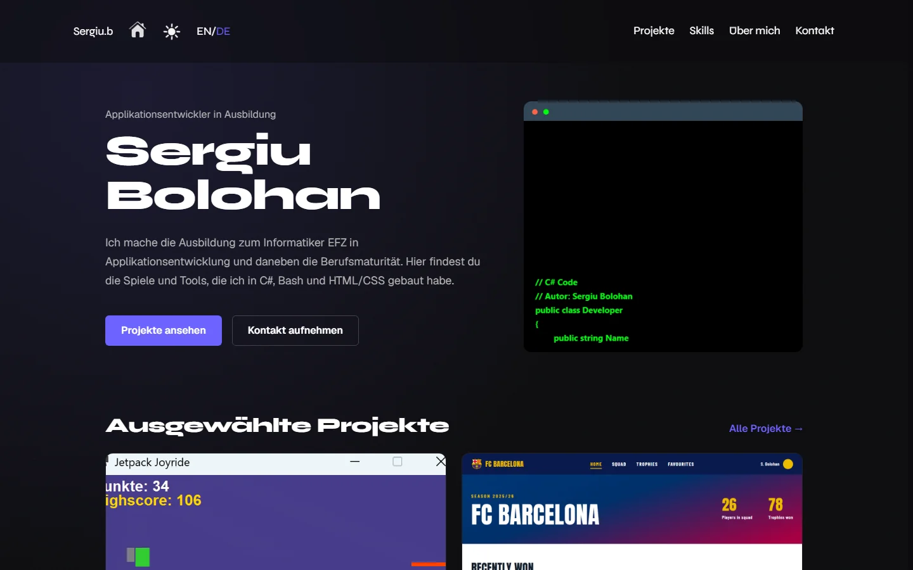
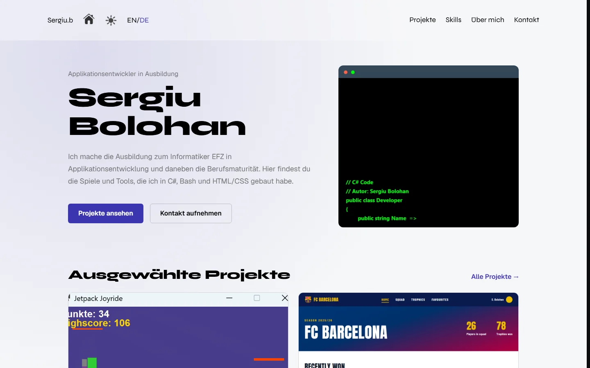
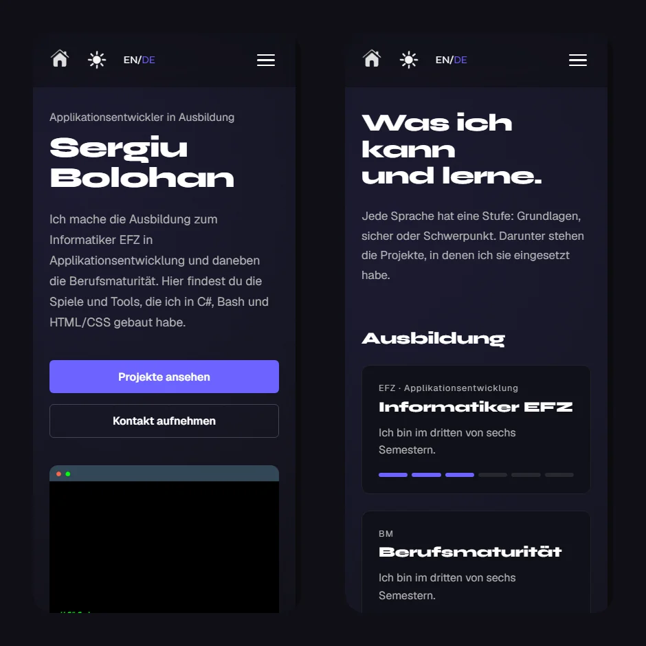
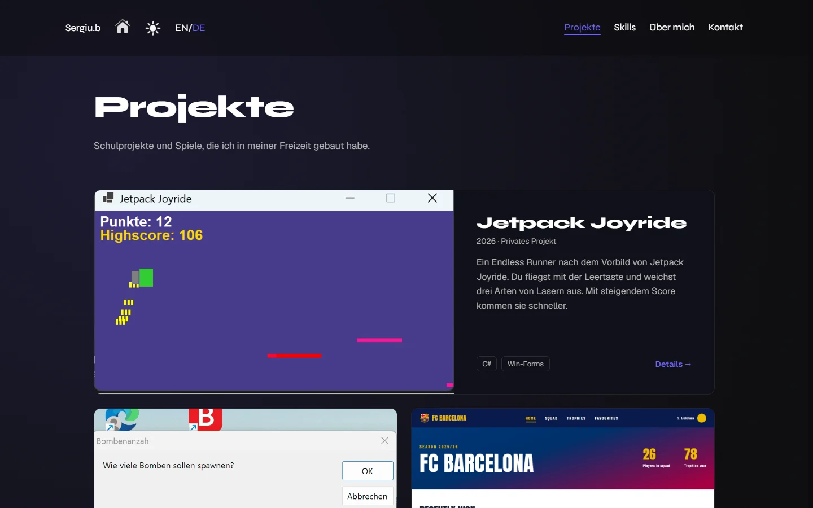
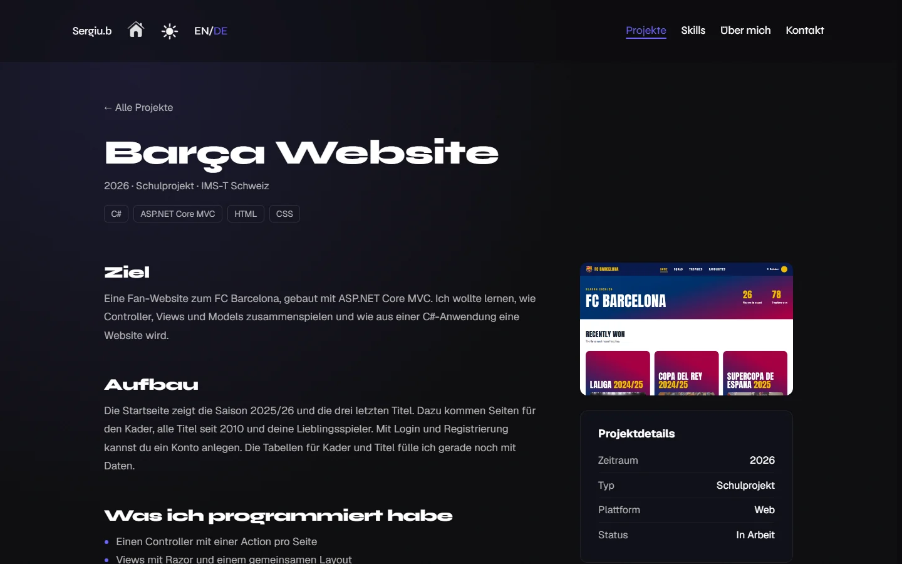

# Sergiu Bolohan – Portfolio

Meine persönliche Portfolio-Website. Ich mache die Ausbildung zum Informatiker EFZ in Applikationsentwicklung an der IMS-T und daneben die Berufsmaturität. Auf der Seite zeige ich meine Projekte, meine Skills und wer ich bin.

**Live:** [sergiubolohan.vercel.app](https://sergiubolohan.vercel.app)

Die Seite ist ein Schulprojekt aus dem Modul 293. Ich habe sie zuerst in Figma entworfen und dann ohne Framework mit HTML, CSS und etwas JavaScript gebaut.



---

## Funktionen

- **Zweisprachig:** Jede Seite gibt es auf Deutsch und auf Englisch. Der Umschalter EN/DE führt direkt zur gleichen Seite in der anderen Sprache.
- **Dark und Light Mode:** Die Wahl wird im Browser gespeichert und gilt auf allen Seiten.
- **Responsive:** Auf dem Handy wird die Navigation zu einem Menü mit Hamburger-Knopf.
- **Projektseiten:** Jedes Projekt hat eine eigene Seite mit Beschreibung, Vorschau, Projektdetails und Link zum Code auf GitHub.
- **Skills mit Stufen:** Jede Technologie hat eine Stufe (Grundlagen, Sicher oder Schwerpunkt) und Links zu den Projekten, in denen ich sie eingesetzt habe.
- **Kontakt:** E-Mail-Adressen mit Kopieren-Knopf, Links zu GitHub und Instagram.
- **Ruhige Seitenwechsel** mit View Transitions. Wer im System «Bewegung reduzieren» eingestellt hat, bekommt keine Animationen.
- **Eigene 404-Seite** auf Deutsch und Englisch.

| Light Mode | Auf dem Handy |
|---|---|
|  |  |

---

## Projekte



| Projekt | Jahr | Typ | Technik | Code |
|---|---|---|---|---|
| Jetpack Joyride | 2026 | Privat | C#, Windows Forms | [Sergius_JetpackJoyride](https://github.com/sxrg1u/Sergius_JetpackJoyride) |
| Bomb Game | 2026 | Privat | C#, Windows Forms | [BombGame](https://github.com/sxrg1u/BombGame) |
| Color Dash | 2026 | Privat, mit Yannick Leutner | Unity, C#, Netcode | [colordash](https://github.com/Colniro/colordash) |
| Barça Website | 2026 | Schule | C#, ASP.NET Core MVC | [BarcaWebsite](https://github.com/sxrg1u/BarcaWebsite) |
| Snake Game | 2026 | Schule | C#, Windows Forms | [Snake-Game](https://github.com/sxrg1u/Snake-Game) |
| Portfolio Website | 2026 | Schule | HTML, CSS, Figma | [portfolio](https://github.com/sxrg1u/portfolio) |
| Getränkeautomat | 2025 | Schule | Bash | [ProjektScriptingGetraenkeautomat](https://github.com/sxrg1u/ProjektScriptingGetraenkeautomat) |

**Jetpack Joyride:** Ein Endless Runner nach dem Vorbild des Handyspiels. Mit der Leertaste fliegst du nach oben und weichst drei Arten von Lasern aus. Je höher der Score, desto schneller und häufiger kommen sie. Der Game-Loop läuft über einen Timer mit etwa 60 Bildern pro Sekunde.

**Bomb Game:** Funktioniert wie Minesweeper. Das Spielfeld wird zur Laufzeit aus Panels erzeugt, die Bomben liegen zufällig in einem 2D-Array. Mit Explosionseffekt, eigenem Partikelsystem und einem Highscore, der in eine Datei gespeichert wird.

**Color Dash:** Ein Partyspiel nach dem Prinzip «Der Boden ist Lava», inspiriert von Fall Guys. Ich habe es zusammen mit Yannick Leutner in Unity gebaut. Das Spiel sagt eine Farbe an, du rennst auf die passende Plattform, und alle anderen verschwinden. Es gibt Online-Multiplayer für bis zu 8 Spieler.

**Barça Website:** Eine Fan-Website zum FC Barcelona mit ASP.NET Core MVC. Sie hat Seiten für Kader, Titel und Lieblingsspieler, dazu Login und Registrierung.

**Snake Game:** Snake in C# mit Windows Forms. Du steuerst die Schlange mit der Tastatur oder mit einem Gamecontroller über die RawGameController-API.

**Portfolio Website:** Diese Website.

**Getränkeautomat:** Ein Getränkeautomat im Terminal, geschrieben in Bash. Das Lager wird zufällig gefüllt. Du zahlst bar, mit TWINT oder PayPal und bekommst das richtige Wechselgeld zurück.



---

## Technik

| Was | Wie |
|---|---|
| Struktur | HTML, eine Datei pro Seite und Sprache |
| Design | Ein gemeinsames Stylesheet `all.css` mit allen Farben, Abständen und Schriftgrössen als CSS-Variablen |
| Schriften | Geist für Text und Syne für Überschriften, beide lokal gehostet als `.woff2` |
| Farben | Eine einzige Akzentfarbe (`--Lila`), die im Light Mode angepasst wird |
| JavaScript | `script.js` für Theme-Umschalter, Handy-Menü und Kopieren-Knöpfe |
| Hosting | Vercel, statische Dateien ohne Build-Schritt |
| Entwurf | Figma |

Es gibt keine externen Abhängigkeiten: keine Frameworks, keine CDNs und keine Schriften von Google.

### Aufbau von `all.css`

Oben stehen die Variablen, die globalen Regeln und die Navigation. Danach folgt pro Seitentyp ein eigener Abschnitt, markiert mit `/* ===== NAME ===== */`:

- Projekt-Detailseiten
- Startseite
- Projekte-Übersicht
- Skills
- Über mich
- Kontakt
- 404-Seite

Wer die Akzentfarbe ändern will, ändert nur `--Lila`, `--LilaHover` und `--LilaLight` oben in `:root` und im Light-Mode-Block.

---

## Ordnerstruktur

```
portfolio/
├── index.html                 Leitet zur Startseite weiter
├── 404.html                   Fehlerseite (DE und EN)
├── all.css                    Gemeinsames Stylesheet
├── script.js                  Theme, Handy-Menü, Kopieren-Knöpfe
├── geist-variable.woff2       Schrift für Text
├── syne-variable.woff2        Schrift für Überschriften
├── 1_hauptseite/              Startseite
├── 2_projekte/                Projektübersicht
├── 3_snake/                   Projekt: Snake Game
├── 4_getraenkeautomat/        Projekt: Getränkeautomat
├── 5_portfolio/               Projekt: diese Website
├── 6_skills/                  Skills und Ausbildung
├── 7_uebermich/               Über mich
├── 8_kontakt/                 Kontakt
├── 9_jetpackprojekt/          Projekt: Jetpack Joyride
├── 10_bombgameprojekt/        Projekt: Bomb Game
├── 11_barcawebsite/           Projekt: Barça Website
├── 12_colordash/              Projekt: Color Dash
├── bilder/                    Bilder, GIFs und Icons der Website
└── docs/screenshots/          Screenshots für dieses README
```

Jeder Seitenordner enthält eine deutsche und eine englische Datei, zum Beispiel `skills.html` und `skillsen.html`.

---

## Lokal starten

Die Seite braucht keinen Build. Im Projektordner einen kleinen Webserver starten:

```bash
python -m http.server 8000
```

Danach [localhost:8000](http://localhost:8000) im Browser öffnen.

Du kannst `index.html` auch direkt per Doppelklick öffnen. Dann funktionieren aber die Links auf der 404-Seite nicht, weil sie vom Hauptordner aus rechnen.

---

## Autor

**Sergiu Bolohan**, Informatiker EFZ in Ausbildung an der IMS-T

- GitHub: [sxrg1u](https://github.com/sxrg1u)
- Website: [sergiubolohan.vercel.app](https://sergiubolohan.vercel.app)
